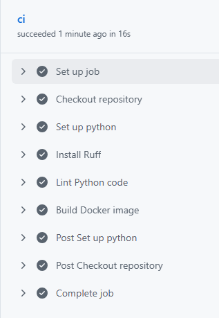
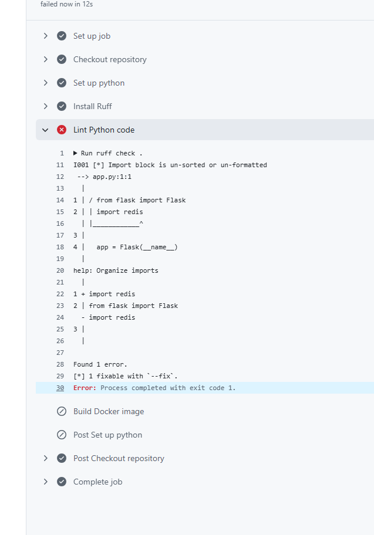
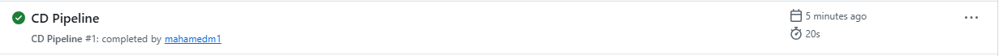
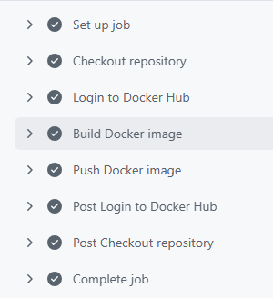
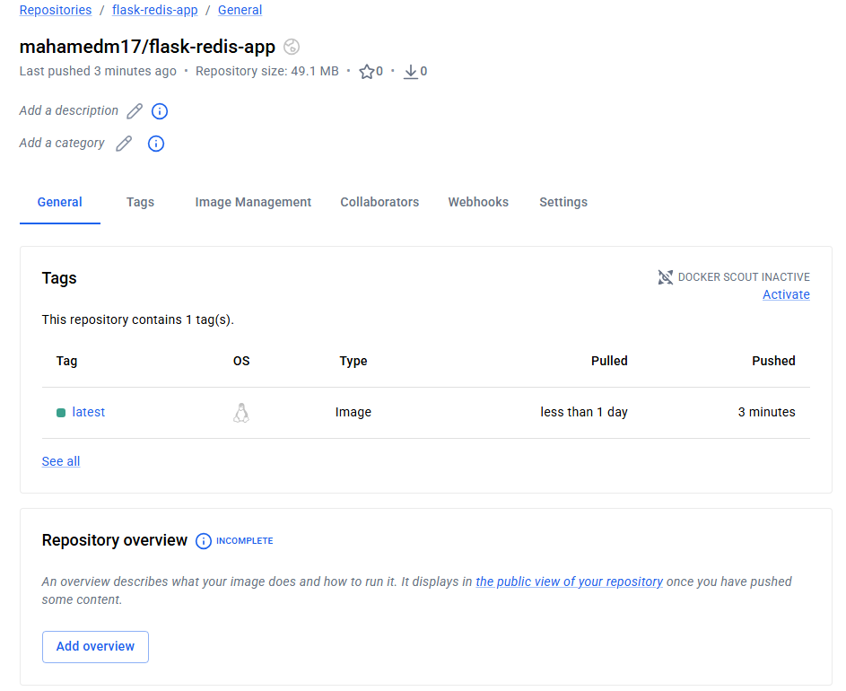
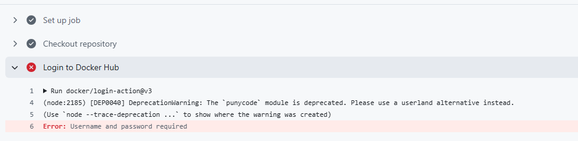
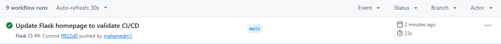

# GitHub Actions CI/CD Pipeline

## Overview

This project demonstrates an automated CI/CD pipeline using GitHub Actions for a containerised Flask application with Redis. The pipeline validates Python code, builds Docker images and automatically publishes them to Docker Hub after successful CI execution.

The project is divided into two workflows:

- **Continuous Integration (CI):** Automated code-quality checks and Docker image build verification.
- **Continuous Delivery (CD):** Automated Docker image publishing to Docker Hub following successful CI execution.

## Architecture

```text
Code Push to Main
       |
       v
GitHub Actions CI
       |
       v
Docker Build
       |
       v
CI Successful
       |
       v
GitHub Actions CD
       |
       v
Docker Hub
```

## Task 1 – Continuous Integration

The CI workflow is defined in `.github/workflows/ci.yml`. It runs automatically when code is pushed to `main` or a pull request targets `main`.

### CI Workflow Steps

1. Checks out the repository using `actions/checkout@v4`.
2. Configures Python 3.12 using `actions/setup-python@v5`.
3. Installs Ruff.
4. Runs `ruff check .` to identify Python code-quality issues.
5. Builds the Flask application Docker image to verify the Dockerfile.

### Successful CI Execution

The workflow successfully completed all configured checks.




### CI Troubleshooting

The initial CI workflow failed because Ruff detected incorrectly ordered imports in `app.py` (`I001`).



The issue was resolved locally by correcting the import order. The corrected code was committed and pushed, automatically triggering another successful CI run.

## Task 2 – Continuous Delivery

The CD workflow is defined in `.github/workflows/cd.yml`. It uses the `workflow_run` trigger to execute after the CI workflow completes on `main`. A job-level condition ensures that Docker images are only published when CI succeeds.

### CD Workflow Steps

1. Checks out the commit associated with the completed CI workflow.
2. Authenticates to Docker Hub using `docker/login-action@v3`.
3. Builds and tags the Flask application image.
4. Pushes the image to Docker Hub.

### Docker Hub Authentication

Docker Hub credentials are stored securely as GitHub Actions repository secrets:

- `DOCKERHUB_USERNAME`
- `DOCKERHUB_TOKEN`

The workflow references these secrets without exposing credentials in the repository.

### Successful CD Execution

The CD workflow successfully authenticated with Docker Hub, built the application image and pushed it to the container registry.





### Docker Image Publishing

The CD workflow builds and publishes the image using:

```bash
docker build -t mahamedm17/flask-redis-app:latest .
docker push mahamedm17/flask-redis-app:latest
```

**Docker Hub Repository:** [mahamedm17/flask-redis-app](https://hub.docker.com/r/mahamedm17/flask-redis-app)



### CD Troubleshooting

The initial CD workflow failed during Docker Hub authentication with the error: `Username and password required`.



The issue was caused by incorrectly named GitHub repository secrets. After configuring `DOCKERHUB_USERNAME` and `DOCKERHUB_TOKEN` correctly, the workflow was rerun and successfully published the Docker image.

## Automated CI/CD Validation

To verify the automation, the Flask homepage response was modified.

**Original:**

```python
return 'Welcome to my homepage'
```

**Updated:**

```python
return 'Welcome to my homepage - Updated using CI/CD!'
```

The change was committed and pushed to the `main` branch, automatically triggering CI and subsequently CD after successful validation.

### Automated Workflow Execution



The successful workflow demonstrates that application changes automatically trigger code validation, Docker image building and publishing without manual intervention.

## Outcome

Successfully implemented an automated CI/CD pipeline using GitHub Actions, incorporating Python linting, Docker image build verification, secure registry authentication and automated image publishing.

The pipeline publishes images to Docker Hub but does not deploy containers to a running environment.
