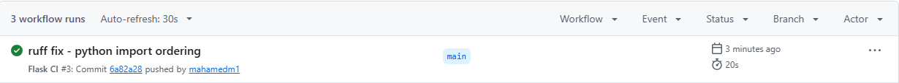

# GitHub Actions CI Pipeline

## Overview

This project demonstrates a basic Continuous Integration (CI) pipeline using GitHub Actions to automate code-quality checks and Docker image builds for a containerised Flask application.

The pipeline automatically runs whenever changes are pushed to the `main` branch or a pull request targets `main`.

## Technologies Used

- **GitHub Actions** – CI automation
- **Python / Flask** – Web application
- **Redis** – Visit counter storage
- **Ruff** – Python linting and code-quality checks
- **Docker** – Container image builds

## CI Pipeline

The workflow is defined in `.github/workflows/ci.yml`.

The pipeline performs the following steps:

1. **Checkout Repository** – Retrieves the latest repository code.
2. **Set Up Python** – Configures Python 3.12 on the GitHub Actions runner.
3. **Install Ruff** – Installs the Python linting tool.
4. **Lint Python Code** – Checks the application for code-quality issues.
5. **Build Docker Image** – Verifies that the application can be successfully packaged into a Docker image.

The workflow runs on a GitHub-hosted Ubuntu runner.

## CI Pipeline Results

### Successful Workflow Run

The workflow completed successfully after the code-quality issue was resolved.

### Successful CI Job

All configured CI steps passed, including Python linting and Docker image building.

## Troubleshooting

During the initial workflow execution, the pipeline failed at the Ruff linting stage.

Ruff detected an incorrectly ordered import block in `app.py` (`I001`), causing the workflow to exit with code `1`.

The issue was resolved by changing the ordering of the import.

The corrected code was committed and pushed to GitHub, automatically triggering another workflow run, which completed successfully.

## Outcome

Successfully implemented and validated an automated CI pipeline using GitHub Actions.

The project demonstrates:

- Automated CI execution on GitHub pushes and pull requests
- Python code-quality validation using Ruff
- Automated Docker image build verification
- Troubleshooting failed CI workflows using GitHub Actions logs
- Git-based development and automated validation

**Status:** CI pipeline successfully implemented and tested.
